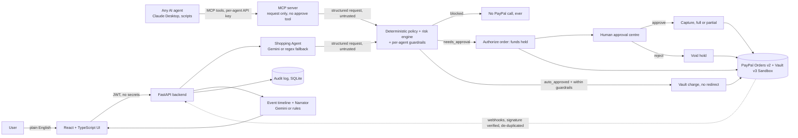

# PayPal AgentGuard

> Let AI agents shop. Let PayPal move the money. Let AgentGuard enforce the rules.

AgentGuard is a **permission and transaction-security layer for AI purchasing agents**, built on **PayPal Orders v2 (Sandbox)**.
An agent (or a person talking to one) says *"Buy a USB-C hub under $40 from Amazon"*. AgentGuard turns that into a structured purchase request, a **deterministic policy engine** decides whether it is auto-approved, needs a human, or is blocked, and only then does PayPal take payment. Gemini helps understand the request and explain the decision, but **it can never approve a payment**.

- Demo video: _add link here_ · Live demo: _add link here_ · Devpost: _add link here_

## Why this matters
Agents are starting to spend real money. Today the choices are "give the agent a card" (dangerous) or "approve every purchase by hand" (useless). Worse, an agent that reads web pages, emails or product listings can be **prompt-injected** into paying for something the owner never wanted. AgentGuard sits between the agent and PayPal with rules the model cannot talk its way past.

## What it does
| Step | What happens |
|---|---|
| 1. Ask | Plain-English request in the **Shopping Agent** box (Gemini parses it; a regex parser takes over if Gemini is unavailable). |
| 2. Decide | The **policy engine** checks amount limits, daily budget, currency, merchant allow/deny lists, duplicates and instruction-like text. A transparent **risk score** can only escalate the result, never relax it. |
| 3. Approve | `blocked` is final. `needs_approval` waits in the **Approval centre** for a human decision with a note. `auto_approved` goes straight on. |
| 4. Pay | Three paths, all behind the policy engine: **Authorize then capture** (funds are held on PayPal, a human approves, then capture or void), **Agent Wallet** (PayPal Vault, auto-approved purchases within guardrails are charged with no redirect), or one-step capture. Idempotent, so refreshes and retries are safe. |
| 5. Prove | Every step is written to an **audit log**; transactions, dashboard and analytics update. Captured payments can be **refunded** from the UI. |
| 6. Trace | A **live per-transaction timeline** merges audit events with verified, de-duplicated PayPal webhook events; Gemini (or rules) can narrate it in plain English. |
| 7. Tune | **Policy Copilot**: say "lower the auto-approve limit to $100", review a diff, and confirm. Nothing is saved without a click. |

## New in the hackathon build (5 phases)
| Feature | What it gives you | Where |
|---|---|---|
| **Authorize, then capture** | `needs_approval` requests create an `AUTHORIZE` order. The buyer approves on PayPal, funds are **held**, nothing is charged until a human approves in the Approval centre. Reject = automatic **void**. Partial capture, reauthorize and an expiry countdown are included. | `services/payments.py`, `PaymentActions.tsx` |
| **Agent Wallet (PayPal Vault v3)** | One-time consent saves a vault token (IDs only). Auto-approved purchases inside per-agent guardrails (daily cap, per-transaction cap, allowed merchants) are charged with **no redirect**. Over a limit it falls back to human approval. One-click **Revoke agent access**. | `services/wallet.py`, `policies/guardrails.py`, `AgentWallet.tsx` |
| **MCP server for any AI agent** | FastMCP tools: `request_purchase`, `check_request_status`, `get_spending_budget`, `list_policies`, `explain_decision`. There is **no approve or capture tool**: agents can only ask. Per-agent hashed API keys, rate limits, audit. | `app/mcp/server.py`, `scripts/mcp_server.py`, [`docs/MCP.md`](docs/MCP.md) |
| **Live event timeline** | Request, policy decision, approval, order, authorization, capture/void/refund and PayPal webhooks in one vertical timeline, polled every 3 s, with a Sandbox webhook simulator (clearly labelled, never changes payment state) and a "Narrate this transaction" button. | `services/timeline.py`, `TransactionTimeline.tsx` |

Demo centrepiece: `python scripts/mcp_client_demo.py` plays an agent making a safe purchase, a large purchase (held for approval) and a prompt-injection purchase (blocked).

Honest labelling is built in: records from the built-in demo carry a **Demo** badge, records that touched PayPal carry a **PayPal Sandbox** badge, and every explanation says whether **Gemini** or **rules** wrote it.

## Architecture

Key rule: the arrows from the Shopping Agent and from MCP agents go **into** the policy engine, never around it. Model output is data; the engine decides.

## Run it in under 5 minutes
Requirements: Python 3.11+, Node 18+.

**1. Backend**
```bash
cd backend
python -m venv .venv && source .venv/bin/activate      # Windows: .venv\Scripts\activate
pip install -r requirements.txt
cp .env.example .env                                   # Windows: copy .env.example .env
# edit .env: PAYPAL_CLIENT_ID, PAYPAL_CLIENT_SECRET, JWT_SECRET (and optionally GEMINI_API_KEY)
uvicorn app.main:app --reload --port 8000
```
**2. Frontend** (new terminal)
```bash
cd frontend
cp .env.example .env          # VITE_DATA_MODE=api
npm install
npm run dev                   # http://localhost:5173
```
**3. PayPal Sandbox credentials** (free, about 3 minutes)
1. https://developer.paypal.com > **Apps & Credentials** > toggle **Sandbox** > **Create App** (Merchant). Copy Client ID and Secret into `backend/.env`.
2. **Testing Tools > Sandbox Accounts**: open the default **Personal** account and note its email and password. That is the buyer you log in as at checkout. No real money is ever involved.
3. Optional: a Gemini key from https://aistudio.google.com. Without it the app still works and labels explanations as rule-based.

**No backend? No problem:** set `VITE_DATA_MODE=demo` for a clearly labelled in-browser simulation (PayPal checkout and the Copilot are disabled in this mode).

**Try it:** Purchase requests > *Run demo scenario* (four contrasting cases), then ask `Renew our Figma team plan for $145`, approve it in the Approval centre, and pay with the sandbox buyer. Full checklist: [`docs/RUN_AND_CHECK.md`](docs/RUN_AND_CHECK.md).

## How PayPal is used
- **Orders v2** `POST /v2/checkout/orders` with `intent=AUTHORIZE` (default for approval-needed requests) or `CAPTURE`; `return_url`/`cancel_url` point at the app.
- **Authorize / capture / void / reauthorize:** `/v2/checkout/orders/{id}/authorize`, `/v2/payments/authorizations/{id}/capture` (partial capture supported), `/void`, `/reauthorize`. Capture is allowed only if the request is approved and amount <= still-authorized amount.
- **Vault v3:** `/v3/vault/setup-tokens`, `/v3/vault/payment-tokens`, and Orders with `payment_source.paypal.vault_id` for no-redirect charges. Only vault IDs are stored. Revoke deletes the payment token.
- Amount and currency always come from the database, never from the browser; a mismatch is written to the audit log.
- **Refunds** use the capture refund endpoint. **Webhooks** are verified with PayPal's signature API when `PAYPAL_WEBHOOK_ID` is set, de-duplicated by event id, never move state backwards, and feed the timeline.
- OAuth tokens are cached; every mutating call sends `PayPal-Request-Id`; network, 429 and 5xx errors are retried with backoff.

## How Gemini is used
Four narrow agents over the Gemini REST API (free tier) with structured JSON output: **Shopping Agent** (text to purchase request, including "using my agent wallet"), **Risk Explainer** (restates the decision and explains the hold: "funds are held, nothing is charged until you approve"), **Policy Copilot** (proposes a policy diff) and **Narrator** (plain-English story of a transaction from its timeline). 429s get a short backoff, then the fallback. Each has a deterministic fallback, so the product works with no key at all. An explanation that contradicts the engine's decision (for example calling a blocked purchase safe) is discarded in favour of rule text.

## Security design
- **The policy engine decides; AI only explains.** Rules are plain Python in `backend/app/policies`, unit-tested. Risk can escalate `auto_approved` to `needs_approval`; nothing can relax a block.
- **Prompt-injection defences:** user and merchant text is wrapped in `<<<UNTRUSTED>>>` delimiters for the model; a heuristic detector blocks instruction-like text ("ignore previous instructions", "auto-approve", "system prompt"...) after Unicode normalisation; model output is schema-validated and never triggers a payment; the original text is shown to humans as quoted data.
- **Secrets are backend-only.** The frontend holds a user JWT in `sessionStorage` and nothing else. PayPal and Gemini keys live in `backend/.env` (git-ignored). `/health` reports whether integrations are configured, never their values.
- **Agents can only ask:** the MCP surface has no approve or capture tool. API keys are shown once and stored as SHA-256 hashes, are revocable, rate-limited, and every call is audited with the agent identity. Agents only see requests they created.
- **Idempotency:** order creation reuses an open order; capture is replay-safe; webhooks are de-duplicated by event id and never move a captured payment backwards.
- **Tenant isolation:** every query is scoped to the authenticated user. Blocked or rejected requests can never reach PayPal (enforced server-side in `ensure_payable`).
- Passwords are bcrypt-hashed; API errors use one uniform shape, and login does not reveal whether an email exists.

## Tests
```bash
cd backend && python -m pytest -q      # 172 tests: policy engine, risk, injection, agents, PayPal client (mocked HTTP), authorize/capture/void, vault wallet, MCP, timeline
cd frontend && npm run build           # strict TypeScript + production build
```
PayPal and Gemini HTTP are mocked in tests. `scripts/paypal_smoke_test.py` runs a real Sandbox order against your credentials.

## What was built during the hackathon
This project was **significantly updated after October 1**.
- **Existed before:** the React/TypeScript frontend shell (login, dashboard, transactions, UI kit, demo data layer).
- **New during the hackathon:** the entire FastAPI + SQLite backend; the deterministic policy and risk engine; prompt-injection defences; the PayPal Orders v2 integration (create, capture, refund, webhooks, idempotency); the three Gemini agents with fallbacks; the audit log; 172 automated tests; Authorize/Capture/Void with expiry handling; the Vault-based Agent Wallet with guardrails; the MCP server with per-agent keys; the live event timeline and narrator; and the full integration of the frontend with the real API (shopping agent chat, approval centre, PayPal checkout/return/cancel/refund flow, Policy Copilot, risk, merchants, audit, analytics and settings pages).

## Project layout
`backend/app` (`api`, `agents`, `policies`, `integrations/paypal.py`, `services`, `models`) · `frontend/src` (`pages`, `components`, `services`, `types`) · `docs/` (API contract, architecture, run guide, Devpost text, video script) · `scripts/` (PayPal smoke test, MCP server, MCP demo client) · `render.yaml` (optional backend deploy).

## Limits, stated plainly
Sandbox only. **Authorize/capture/void/reauthorize, Vault and webhooks are covered by mocked-HTTP tests; they have not all been verified against a live Sandbox account** (Vault must be enabled on your PayPal app; if not, the UI shows how to enable it and everything else keeps working; PayPal only accepts reauthorize after the 3-day honor period). The timeline uses 3-second polling, not SSE. Refunds work on the last capture only. SQLite for one-command setup (use Postgres for production); risk scoring is rule-based, not a trained fraud model; the prompt-injection detector is a heuristic layer on top of the architectural guarantee (the engine, not the model, decides). MCP HTTP mode reads the key from request headers; if your `mcp` SDK version differs, use stdio.

License: see [LICENSE](LICENSE).
